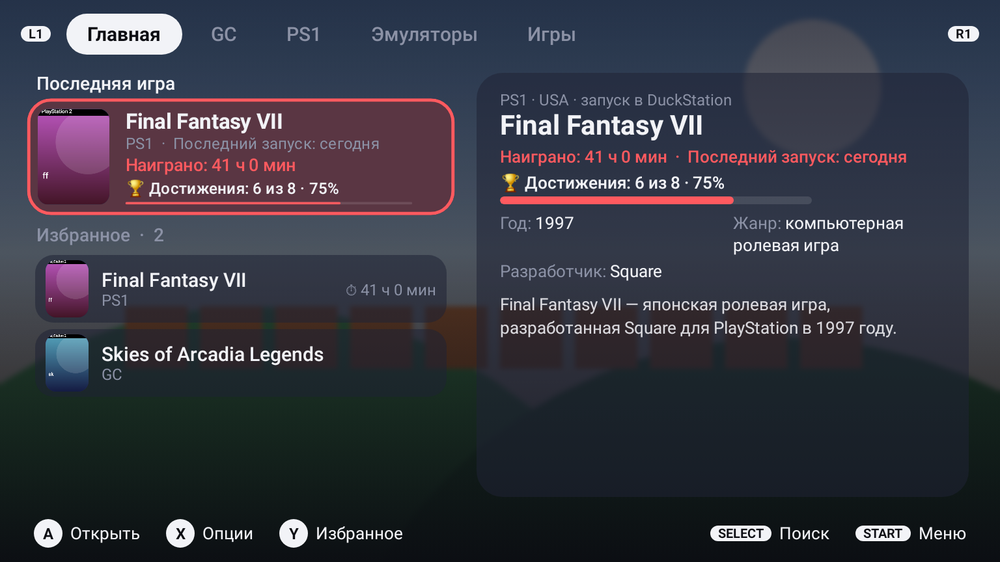
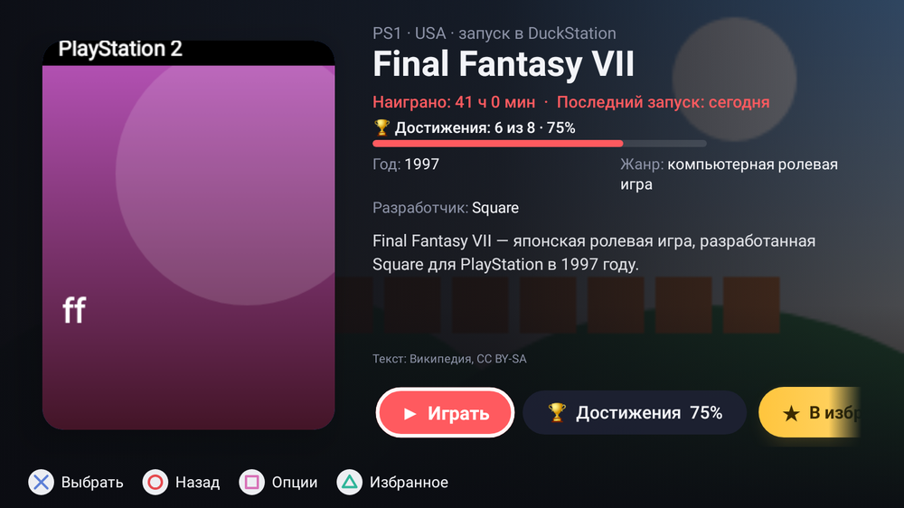
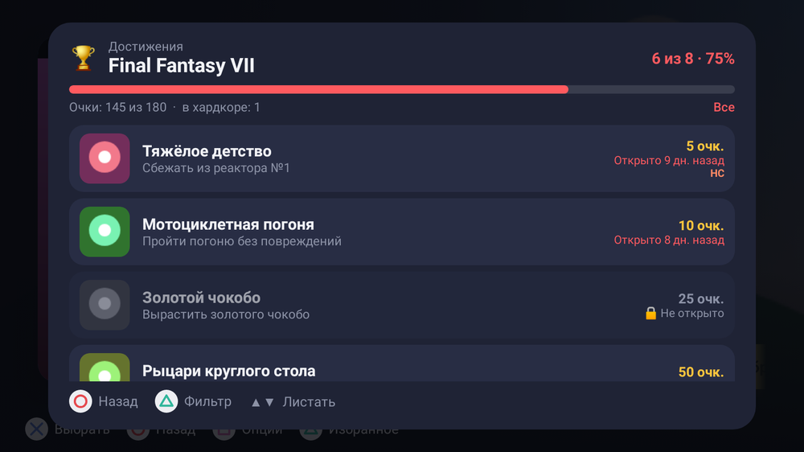
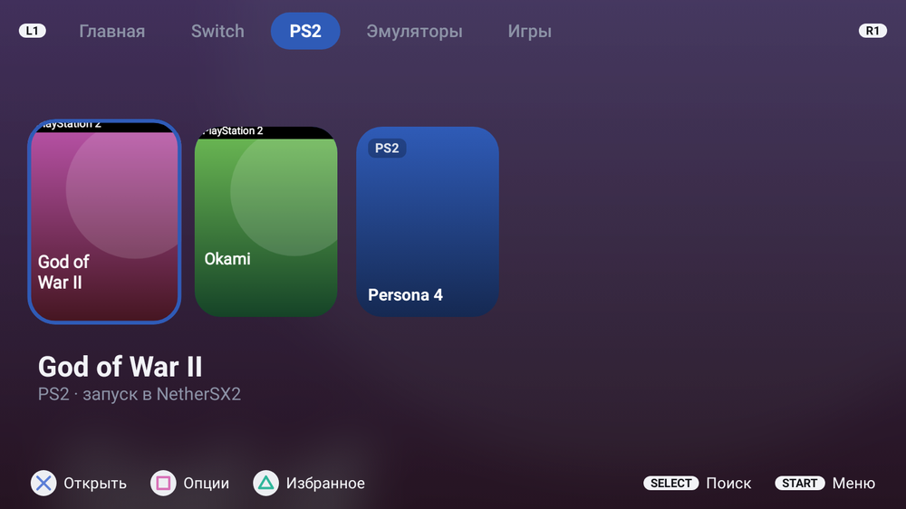

# Retro Home

**Лаунчер для ретро-приставок на Android: в горизонтальном положении — консоль, в вертикальном — обычный телефон.**

Создан для Retroid Pocket G2, но работает на любом Android-устройстве с Android 10 и новее: на других ретро-консолях (AYN Odin, Anbernic, Retroid Pocket 4/5/Mini…), планшетах и телефонах с геймпадом.

[English below](#english)

<p align="center">
  
  
</p>
<p align="center">
  
  
</p>

> Снимки сделаны автоматическими тестами, поэтому вместо настоящих обложек — цветные заглушки.

## Возможности

### Консольный режим (горизонтально)
- **Вкладки по консолям:** лаунчер сам находит игры в папке ROMs и раскладывает их по системам: PS1, PS2, PSP, GameCube, Wii, Switch, 3DS, DS, GBA, SNES, N64, Mega Drive, Dreamcast и другие.
- **Запуск в нужном эмуляторе одной кнопкой.** Лаунчер распознаёт RetroArch, DuckStation, ARMSX2, NetherSX2/AetherSX2, PPSSPP, Dolphin, Citra/Azahar, Eden/Yuzu, melonDS, DraStic, Flycast, Redream, Mupen64Plus, Lemuroid, MD.emu и другие эмуляторы Explusalpha, My Boy!, Pizza Boy, Vita3K, ScummVM, JoiPlay, MAME4droid и другие. Эмуляторы, которых нет в списке, подхватываются автоматически: лаунчер определяет консоль по названию и запускает игры в них напрямую. Для каждой консоли эмулятор можно выбрать вручную.
- **Обложки и снимки из игр** из открытой базы libretro-thumbnails. Для Switch — свои обложки.
- **Описания, жанр, разработчик и год** из Википедии и Викиданных на русском и английском. Лаунчер учитывает консоль, поэтому ремейк не попадёт вместо оригинала.
- **Страница игры:** описание, факты, время в игре, выбор диска для многодисковых игр.
- **Достижения [RetroAchievements](https://retroachievements.org):** прогресс в процентах и полный список, с фильтром «ещё не открытые». Картриджные игры опознаются по отпечатку файла, как это делает сам эмулятор.
- **Учёт времени в играх.** С доступом к статистике использования Android считается точно, даже если вернуться в игру из списка открытых приложений.
- **Главная вкладка:** последняя игра и избранное со всей информацией об игре.
- **Управление кнопками и касанием:** значки кнопок в стиле консоли (✕○□△ для PlayStation, цветные A/B/X/Y для Nintendo), вибрация, звуки интерфейса и фоновая музыка (все звуки синтезированы с нуля, см. `tools/synth.py`).
- **Оформление:** 4 темы (ночь, OLED-чёрная, графит, светлая), 8 цветов выделения, вкладки окрашиваются в цвет консоли; порядок и скрытие вкладок.

### Телефонный режим (вертикально)
- Рабочий стол с папками, док, список всех приложений с поиском.
- Виджеты Android с перетаскиванием и изменением размера.
- Жесты: свайп вниз — уведомления, вверх — все приложения.
- Наборы значков (формат Nova/ADW) с возможностью вернуть обычные значки.

## Установка

1. Скачайте `RetroHome-*.apk` из раздела [Releases](../../releases) и установите (может понадобиться разрешить установку из неизвестных источников).
2. Нажмите кнопку «Домой» и выберите **Retro Home** как приложение по умолчанию. Если хотите оставить свой лаунчер — просто открывайте Retro Home значком из списка приложений: он запустится как обычное приложение в консольном режиме.
3. В консольном режиме: **START → Папка ROMs**, выберите папку с играми (вложенные папки вида `psx`, `ps2`, `gba`… распознаются автоматически).

Особые случаи:
- **PS Vita (Vita3K):** игры запускаются по номеру вида `PCSE00120`. Подойдут заглушки ES-DE — файлы `.psvita` с номером внутри — или номер в имени файла: `Игра [PCSE00120].vpk`.
- **Lemuroid** открывает игры только из своей библиотеки. Чтобы запускать игру сразу, создайте в Lemuroid её ярлык (удерживайте игру → «Создать ярлык»), когда Retro Home — главный экран.

Необязательные настройки (**START → Настройки**):
- **Почта для Википедии.** С ней описания загружаются в десятки раз быстрее: Википедия разрешает 200 запросов в минуту вместо 10.
- **RetroAchievements.** Логин и ключ Web API с сайта (раздел Settings → Keys) для показа достижений.
- **Доступ к истории использования** — для точного учёта времени в играх.

## Сборка из исходников

Понадобятся JDK 21 и Android SDK (compileSdk 36).

```bash
git clone https://github.com/fenomen64/retro-home.git
cd retro-home
./gradlew testDebugUnitTest   # тесты, включая отрисовку экранов (Robolectric)
./gradlew assembleDebug       # app/build/outputs/apk/debug/app-debug.apk
```

Снимки экранов из тестов: `./gradlew testDebugUnitTest -Proborazzi.test.record=true`, результат в `app/build/screenshots`.

Чтобы подписывать сборки своим ключом (тогда обновления встают поверх), скопируйте `keystore.properties.example` в `keystore.properties` и укажите свой ключ. Без этого файла сборка подписывается отладочным ключом.

**Стек:** Kotlin, Jetpack Compose, kotlinx.serialization; тесты на Robolectric и Roborazzi.

## Конфиденциальность

Лаунчер не собирает никакой статистики и не отправляет данные о вас. Сетевые запросы идут только туда, откуда берутся обложки, описания и достижения:

| Куда | Зачем |
|---|---|
| thumbnails.libretro.com | обложки и снимки из игр |
| wikipedia.org, wikidata.org | описания и факты; если вы указали почту, она передаётся в подписи запросов, как требуют правила Википедии |
| tinfoil.media | обложки и описания игр Switch |
| retroachievements.org, media.retroachievements.org | достижения (только если вы указали аккаунт; ключ уходит только туда) |

Всё загруженное хранится на устройстве; дальше лаунчер работает без интернета.

## Благодарности

- [libretro-thumbnails](https://github.com/libretro-thumbnails/libretro-thumbnails): обложки и снимки.
- [Википедия](https://www.wikipedia.org) и [Викиданные](https://www.wikidata.org): тексты описаний (CC BY-SA) и факты (CC0).
- [RetroAchievements](https://retroachievements.org) и [rcheevos](https://github.com/RetroAchievements/rcheevos): правила подсчёта отпечатков файлов.
- [tinfoil.media](https://tinfoil.media): база игр Switch.

Лаунчер не содержит игр и BIOS и не помогает их скачивать.

## Лицензия

[GNU GPL v3.0](LICENSE): пользуйтесь, изучайте, дорабатывайте и распространяйте; доработки тоже должны оставаться открытыми.

---

<a id="english"></a>

# Retro Home (English)

**An Android launcher for retro handhelds: a console UI in landscape, a regular phone home screen in portrait.**

Built for the Retroid Pocket G2, but it works on any device with Android 10+: other handhelds (AYN Odin, Anbernic, Retroid Pocket 4/5/Mini…), tablets and phones with a controller.

### Features
- **Console mode:** tabs per system built automatically from your ROMs folder; one-button launch in the right emulator (RetroArch, DuckStation, ARMSX2, NetherSX2/AetherSX2, PPSSPP, Dolphin, Citra/Azahar, Eden/Yuzu, melonDS, DraStic, Flycast, Redream, Lemuroid, Vita3K, ScummVM and more; unknown emulators are detected automatically by name and file support); box art and in-game snaps from libretro-thumbnails; descriptions, genre, developer and year from Wikipedia/Wikidata (in Russian and English, matched to the right console); a game page with playtime and disc selection; **RetroAchievements** progress and full achievement lists; the last-played game and favorites on the home tab; console-styled button glyphs, haptics, UI sounds and music; 4 themes and 8 accent colors.
- **Phone mode:** home screen with folders and dock, app drawer with search, Android widgets, gestures, icon packs.
- The UI is available in Russian and English.

### Install
Download the APK from [Releases](../../releases), set Retro Home as the default home app (or keep your launcher and open Retro Home from the app drawer: it runs as a regular app in console mode), then open **START → ROMs folder** and pick your games folder. PS Vita games need their title ID (ES-DE `.psvita` stubs or `[PCSE00120]` in the file name); Lemuroid launches a game directly once you create its shortcut in Lemuroid while Retro Home is the home screen.

### Build
JDK 21 and the Android SDK (compileSdk 36): `./gradlew testDebugUnitTest assembleDebug`. To sign with your own key, copy `keystore.properties.example` to `keystore.properties`.

### Privacy
No analytics or tracking. The only network requests go to libretro thumbnails, Wikipedia/Wikidata, tinfoil.media (Switch) and RetroAchievements (only if you add your account).

### License
[GNU GPL v3.0](LICENSE).
